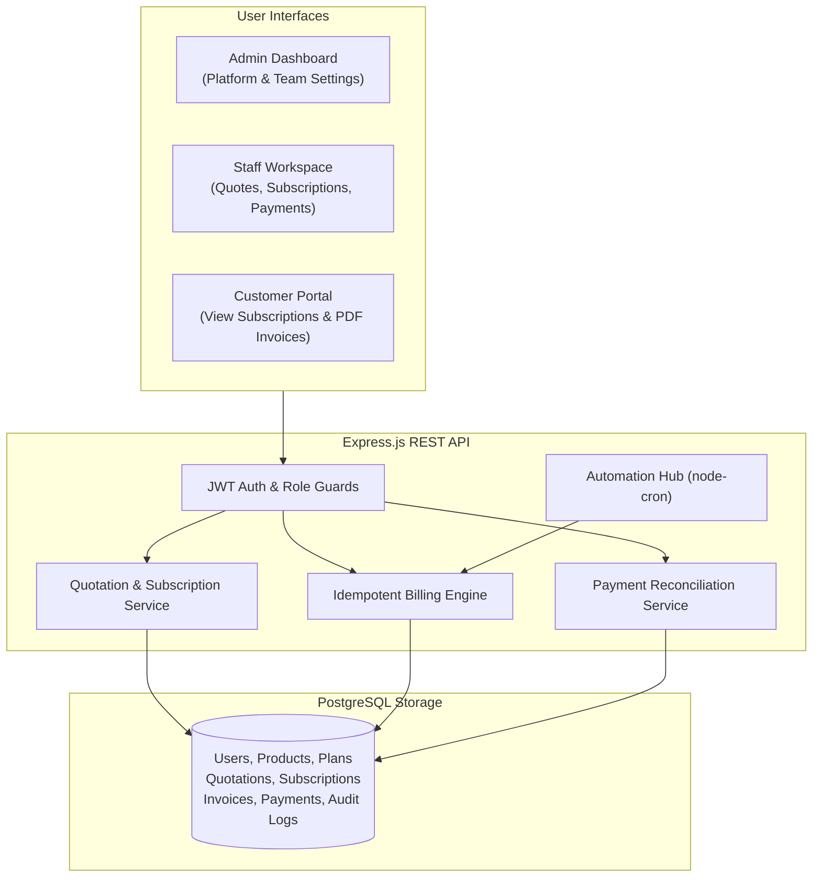
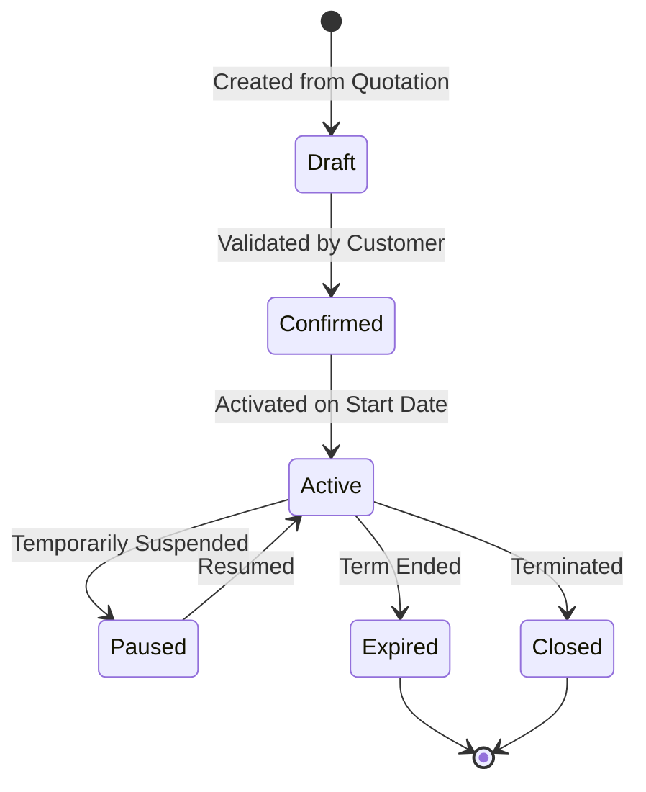

# ⚡ Brightloop Subscription Management System
> **Odoo Hackathon Project** — A complete, reliable, and user-friendly web application for managing recurring subscriptions, automated invoicing, customer self-service, and financial reporting.


---

## 👋 Welcome!

If you've ever tried running a subscription or recurring service business on spreadsheets, you probably know the chaos:
* 📅 **Missed renewals**: Someone forgot to check which contracts expired at the end of the month.
* 💥 **Double-billing disasters**: A script runs twice or a page gets refreshed, and a client gets billed twice in 5 minutes.
* 🧩 **Messy payment reconciliation**: A customer pays half their bill through UPI, half via bank wire, and no one knows what the remaining balance is.
* 📉 **Revenue guesswork**: When leadership asks *"What is our exact MRR this month?"*, people spend hours compiling numbers manually.

We built the **Brightloop Subscription Management System** to tackle all of this head-on. Inspired by the Odoo Subscription problem statement, this application gives businesses a clean, robust, and automated hub for their recurring revenue—built entirely with **free, open-source technologies** so anyone can run, inspect, and deploy it without vendor lock-in or paid API fees.

---

## 🚀 Quick Start (Up & Running in Under 2 Minutes)

You don't even need to install PostgreSQL or configure external cloud accounts to test the app! It comes with a **zero-config in-memory database engine** that automatically persists data to disk.

### 1. Clone & Install
```bash
git clone https://github.com/tc484472-byte/odoo.git
cd odoo

# Install server dependencies
cd server
npm install --legacy-peer-deps

# Install client dependencies
cd ../client
npm install
```

### 2. Start the App
Open two terminals:

**Terminal 1 (Backend API):**
```bash
cd server
npm start
# 🟢 API running at http://localhost:5000
```

**Terminal 2 (Frontend React):**
```bash
cd client
npm run dev
# 🟢 Frontend live at http://localhost:5173
```

Open **`http://localhost:5173`** in your browser.

---

## 🎭 1-Click Demo Accounts

To make reviewing as easy as possible, the top navigation bar features a **One-Click Demo Switcher** that lets you instantly jump between user roles:

| Role | Demo Email | Password | What You Can Explore |
| :--- | :--- | :--- | :--- |
| 👑 **Administrator** | `admin@brightloop.io` | `Password@123` | Full control: Company analytics, team management (add staff/admins), create plans, configure taxes & discounts, trigger automation jobs. |
| 💼 **Internal Staff** | `staff@brightloop.io` | `Password@123` | Sales & operations: Build quotations, convert them to subscriptions with 1 click, view customers, record payments. |
| 👤 **Customer** | `customer@brightloop.io` | `Password@123` | Self-service portal: View own subscriptions, check renewal dates, download official PDF tax invoices. |

---

## 💡 The Brightloop Case Study: Real-World Pricing

The application includes realistic demonstration data built around the hackathon scenario (**Brightloop Software** selling its Core ERP with an Odoo Brand variant):

```
Base Subscription (Brightloop ERP Core)      :   ₹12,000.00 / month
+ Product Variant (Odoo Brand Variant)        :     +₹560.00
------------------------------------------------------------------
Subtotal                                     :   ₹12,560.00
- Promotional Discount (10% First-Time Rule) :   -₹1,256.00
------------------------------------------------------------------
Taxable Amount                               :   ₹11,304.00
+ Applicable Tax (18% GST)                   :   +₹2,034.72
==================================================================
Total Payable                                :   ₹13,338.72
```

Every quotation, recurring invoice, and test in our automated suite verifies this exact mathematical calculation down to the paisa.

---

## ✨ What the System Does

### 1. Sales & Quotations (From Pitch to Active Subscription in 1 Click)
* Sales reps pick a customer, choose a subscription plan (Daily, Weekly, Monthly, or Yearly), and select products with real-time variant additions (e.g., base ₹12,000 + ₹560 variant).
* Eligible discounts and GST rates are calculated on the fly.
* When the client agrees, clicking **"Confirm & Create Subscription"** instantly transitions the quote into an active recurring subscription without retyping any information.

### 2. Idempotent Recurring Invoicing (Sleep Soundly at Night)
* The biggest risk in recurring billing is double-charging. We solved this at the database level with a composite unique constraint: `UNIQUE(subscription_id, billing_period_start)`.
* Whether a scheduled cron job fires, a webhook retries, or an admin clicks "Run Billing" three times, **it is physically impossible to generate duplicate invoices for the same billing window**.
* Invoices automatically calculate line items, subtotals, applied discounts, and taxes, and offer **1-click PDF download** for printing or emailing.

### 3. Payment Reconciliation (Partial & Full Payments)
* Customers don't always pay in full. When a client pays ₹5,000 of their ₹13,338.72 bill via UPI:
  * The ledger logs the payment and transaction reference.
  * The invoice's outstanding balance drops to ₹8,338.72.
  * When the remaining ₹8,338.72 is settled via bank transfer, the invoice automatically flips to `Paid`.

### 4. Background Automation Hub
* **Daily Recurring Invoicing**: Finds active subscriptions due today, generates invoices, and cleanly advances the next billing date.
* **7-Day Renewal Reminders**: Scans for subscriptions reaching their end date within a week and triggers reminder notifications.
* **Overdue Detection**: Marks unpaid invoices past their due date as `Overdue`.
* **Expiry Detection**: Safely transitions past subscriptions to `Expired`.

### 5. Clear Executive Dashboard
* Real-time financial health cards: **MRR (Monthly Recurring Revenue)**, **ARR (Annual Recurring Revenue)**, Total Invoiced, Collected, and Outstanding.
* Visual breakdowns with interactive charts: 6-month revenue trends, payment status distribution, and plan popularity.

---

## 🛠️ Technology Stack & Why We Chose It

We picked modern, proven, and accessible tools so that this project is simple to run locally and free to deploy:

* **Frontend**:
  * **React 19 + Vite**: Modern, snappy component development with rapid build times.
  * **Tailwind CSS v3**: Clean, responsive styling that looks great on mobile, tablet, and desktop.
  * **Recharts**: Clear, interactive SVG charts that don't bog down the browser.
  * **Lucide React**: Clean, lightweight icons throughout the UI.
  * **jsPDF**: Generates tax-compliant PDF invoices client-side.

* **Backend**:
  * **Node.js & Express.js**: Fast, predictable REST API following a clean controller-service architecture.
  * **JWT & bcryptjs**: Secure password hashing (10 salt rounds) and role-scoped authorization (`admin`, `staff`, `customer`).
  * **express-rate-limit**: Protects login and billing endpoints against brute force attempts.

* **Database (Dual Mode)**:
  * **Production**: PostgreSQL on **Supabase Free Tier**.
  * **Local / Demo Mode**: An in-memory PostgreSQL engine (`pg-mem`) with automated disk snapshots (`server/data/db_snapshot.json`). You can test everything immediately without installing local Postgres.

* **Automation**:
  * **node-cron**: Internal scheduler running background jobs locally.
  * **GitHub Actions**: `.github/workflows/billing-cron.yml` provides a free external scheduler to ping the deployed API once a day.

---

## 🔄 How It Works Under the Hood

### System Architecture


### The Subscription Lifecycle


---

## 🧪 Automated Testing (35/35 Passing)

We believe that financial and billing software must be tested thoroughly. The project includes an automated test harness covering password security, financial math, variant calculations, idempotency, and lifecycle state changes.

### Run Tests:
```bash
cd server
npm test
```

### What Is Tested:
```
===============================================================
🧪 RUNNING COMPREHENSIVE SUBSCRIPTION MANAGEMENT SYSTEM TESTS
===============================================================
[Suite 1: Validation & Security]
  ✅ PASS: Valid password accepted
  ✅ PASS: Short password rejected
  ✅ PASS: Password without uppercase rejected
  ✅ PASS: Password without lowercase rejected
  ✅ PASS: Password without special character rejected
  ✅ PASS: Valid email accepted
  ✅ PASS: Invalid email format rejected

[Suite 2: Role-Based Users & Customer Isolation]
  ✅ PASS: Admin account exists
  ✅ PASS: Staff account exists
  ✅ PASS: Customer accounts exist

[Suite 3: Product Variants & Price Calculations]
  ✅ PASS: Core product exists
  ✅ PASS: Odoo Brand variant exists
  ✅ PASS: Odoo Brand variant adds exactly ₹560
  ✅ PASS: Base (₹12,000) + Variant (₹560) = ₹12,560 calculated correctly

[Suite 4: Subscription Plans]
  ✅ PASS: Multiple plans configured
  ✅ PASS: Monthly plan available
  ✅ PASS: Yearly plan available

[Suite 5: Date & Period Calculations]
  ✅ PASS: Advance monthly adds 1 month
  ✅ PASS: Advance yearly adds 1 year
  ✅ PASS: Advance weekly adds 7 days
  ✅ PASS: Advance daily adds 1 day

[Suite 6: Recurring Billing Engine & Invoicing]
  ✅ PASS: Billing engine executed successfully

[Suite 7: Duplicate Invoice Prevention (Idempotency)]
  ✅ PASS: Second billing run executed without error
  ✅ PASS: Second run generated 0 new invoices (duplicate prevention active!)
  ✅ PASS: Subscription safely skipped because billing period was already invoiced

[Suite 8: Financial Calculations (Taxes & Discounts)]
  ✅ PASS: 10% discount on ₹12,560 is ₹1,256
  ✅ PASS: 18% GST on ₹11,304 is ₹2,034.72
  ✅ PASS: Final total is ₹13,338.72

[Suite 9: Payment Processing & Reconciliation]
  ✅ PASS: Partial payment correctly reduces outstanding balance
  ✅ PASS: Amount paid correctly updated

[Suite 10: Overdue Detection Engine]
  ✅ PASS: Overdue check completed without failure

[Suite 11: Renewal Reminders]
  ✅ PASS: Renewal reminders check completed without failure

[Suite 12: Subscription Lifecycle State Machine]
  ✅ PASS: Subscription transitioned from active to paused
  ✅ PASS: Subscription transitioned from paused to active

[Suite 13: Automation & Audit Logs]
  ✅ PASS: Automation execution logs recorded

===============================================================
🎉 TEST SUMMARY: 35 PASSED, 0 FAILED
===============================================================
```

You can also run the quick bug verification test anytime:
```bash
node server/tests/verify_issues.js
# Confirms customer persistence, secondary admin creation, and expiry checks
```

---

## 🔒 Security & Customer Privacy

* **Strict Customer Isolation**: Customer accounts can only view their own quotations, subscriptions, and invoices. An ID tampering attempt on `/api/customers/1` or `/api/invoices/1` immediately returns `403 Forbidden`.
* **Password Complexity**: All passwords must be at least 8 characters and include uppercase, lowercase, and special characters.
* **Audit Trail**: Every significant action (creating quotes, activating subscriptions, recording payments, modifying user statuses) logs an entry to the `audit_logs` table with actor ID, timestamp, and IP address.

---

## ☁️ Zero-Cost Production Deployment

You can deploy the entire stack for free using these three services:

1. **Database — Supabase (Free Tier)**
   * Create a project at [supabase.com](https://supabase.com).
   * Copy your connection URI from **Project Settings $\rightarrow$ Database**.
   * Run the SQL statements from [`server/migrations/schema.sql`](server/migrations/schema.sql) in the Supabase SQL Editor.

2. **Backend — Render (Free Tier)**
   * Create a new Web Service at [render.com](https://render.com) connected to this repository.
   * Root Directory: `server`
   * Build Command: `npm install --legacy-peer-deps`
   * Start Command: `npm start`
   * Set Environment Variables: `DATABASE_URL`, `JWT_SECRET`, and `CLIENT_URL`.

3. **Frontend — Vercel (Free Tier)**
   * Import the repository at [vercel.com](https://vercel.com).
   * Root Directory: `client`
   * Environment Variable: `VITE_API_URL` set to your Render backend URL.
   * Deploy!

---

## 📂 Project Structure

```
odoo/
├── client/                     # Frontend React application
│   ├── src/
│   │   ├── components/         # Reusable UI (Navbar, Sidebar, Modal, Badges)
│   │   ├── context/            # AuthContext & Session management
│   │   ├── pages/              # Dashboard, Quotes, Invoices, Subscriptions, etc.
│   │   └── services/           # Axios API client wrapper
│   ├── package.json
│   └── vite.config.js
│
├── server/                     # Backend Node.js / Express API
│   ├── controllers/            # Route controllers (Auth, Billing, Customers, etc.)
│   ├── middleware/             # JWT auth, validation, rate limiting, audit logging
│   ├── migrations/             # schema.sql (PostgreSQL) and seed.js
│   ├── routes/                 # Express REST endpoint declarations
│   ├── services/               # Core business logic (billingService.js)
│   ├── tests/                  # run-tests.js (35 test assertions)
│   ├── db.js                   # Dual-mode PostgreSQL connection manager
│   ├── index.js                # Express app entrypoint & cron initialization
│   └── package.json
│
├── .github/workflows/          # GitHub Actions recurring billing cron trigger
└── README.md                   # You are here!
```

---

## 📄 License
This project is open-source and free to use under the [MIT License](LICENSE).

*Built with passion for the Odoo Hackathon.*
