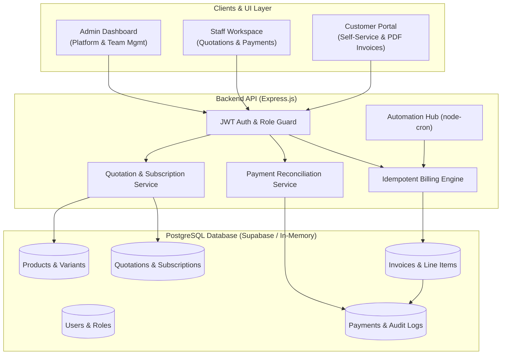
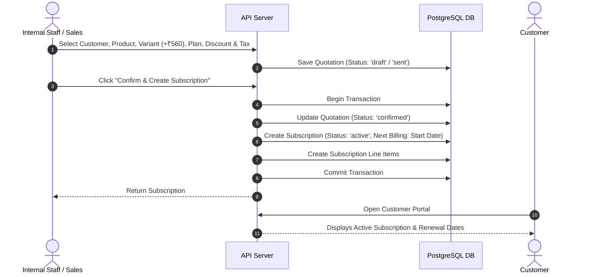
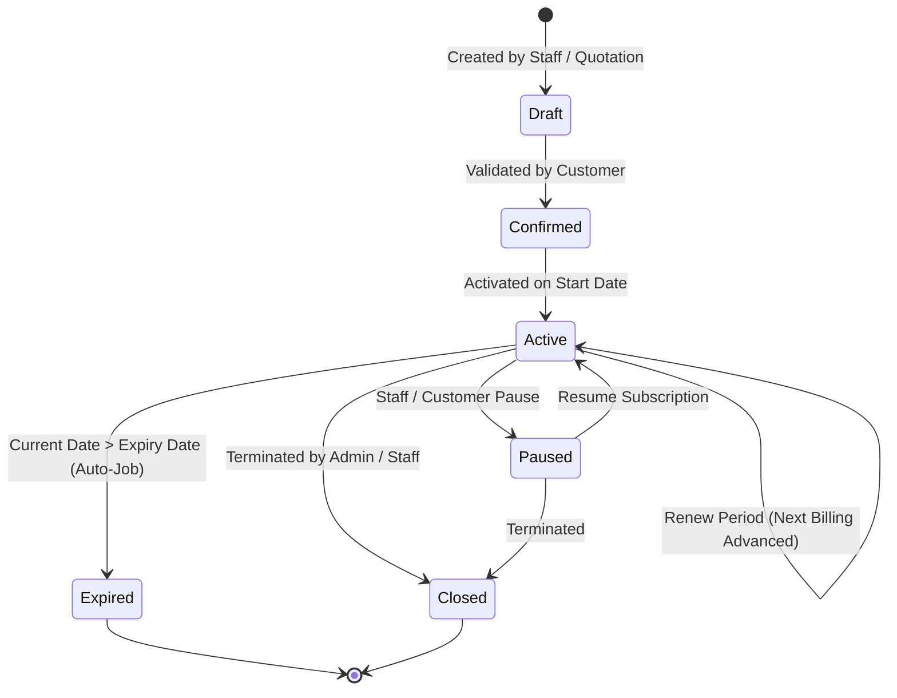
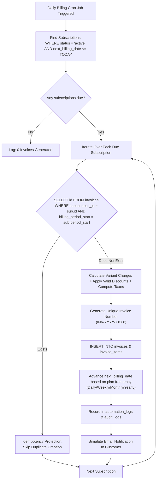
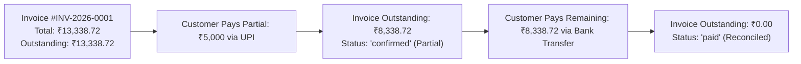
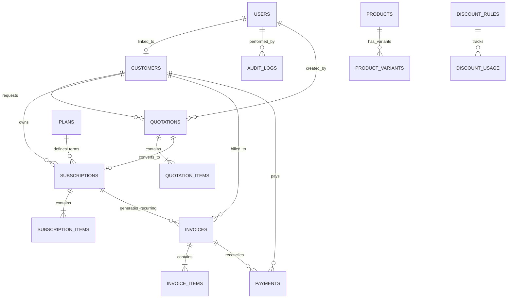

# Brightloop Subscription Management System
> Odoo Hackathon Solution — Subscription Management, Recurring Billing Engine, Quotations, and Customer Self-Service Portal.


---

## Table of Contents
- [Overview](#overview)
- [Quick Start](#quick-start)
- [Demo Credentials](#demo-credentials)
- [Pricing Case Study](#pricing-case-study)
- [Tech Stack](#tech-stack)
- [Architecture & Workflows](#architecture--workflows)
  - [System Architecture](#system-architecture)
  - [Quotation-to-Subscription Workflow](#quotation-to-subscription-workflow)
  - [Subscription Lifecycle](#subscription-lifecycle)
  - [Idempotent Recurring Billing](#idempotent-recurring-billing)
  - [Payment Reconciliation](#payment-reconciliation)
- [Database Schema](#database-schema)
- [User Roles & Permissions](#user-roles--permissions)
- [Core Features](#core-features)
- [Testing](#testing)
- [Security](#security)
- [API Specification](#api-specification)
- [Deployment](#deployment)
- [Project Structure](#project-structure)
- [License](#license)

---

## Overview

Managing recurring billing and subscriptions with spreadsheets creates major operational bottlenecks:
* **Missed Renewals**: Contracts expiring without notice, causing lost recurring revenue.
* **Double-Billing**: Concurrent requests or script restarts charging customers twice in the same billing cycle.
* **Reconciliation Gaps**: Partial payments across UPI, bank transfer, and cash left untracked.
* **Financial Uncertainty**: Inability to report live Monthly Recurring Revenue (MRR) or Annual Recurring Revenue (ARR).

The Brightloop Subscription Management System eliminates these issues:
* Automates recurring invoicing with a scheduled billing engine.
* Prevents double-billing using database-level unique constraints.
* Supports multi-variant pricing, dynamic discounts, and configurable tax rules.
* Provides role-based portals for administrators, sales/operations staff, and customers.
* Built entirely with free and open-source tools with zero paid API dependencies.

---

## Quick Start

The project includes an in-memory PostgreSQL engine (`pg-mem`) with automated disk persistence. You can clone and run it immediately without setting up external database accounts.

### 1. Clone & Install
```bash
git clone https://github.com/tc484472-byte/odoo.git
cd odoo

# Install backend dependencies
cd server
npm install --legacy-peer-deps

# Install frontend dependencies
cd ../client
npm install
```

### 2. Start Application
Run both services in separate terminals:

**Terminal 1 (Backend API):**
```bash
cd server
npm start
# Server running at http://localhost:5000
```

**Terminal 2 (Frontend Client):**
```bash
cd client
npm run dev
# Application running at http://localhost:5173
```

Open `http://localhost:5173` in your browser.

---

## Demo Credentials

The top navigation bar contains a One-Click Persona Switcher for testing:

| Role | Email | Password | Permissions |
| :--- | :--- | :--- | :--- |
| **Administrator** | `admin@brightloop.io` | `Password@123` | Full control: Company analytics, team management, plans, taxes, discounts, automation triggers |
| **Internal Staff** | `staff@brightloop.io` | `Password@123` | Sales & operations: Quotations, subscriptions, customer records, payment entries |
| **Customer** | `customer@brightloop.io` | `Password@123` | Self-service: Own subscriptions, payment status, PDF invoice downloads |

---

## Pricing Case Study

The application contains demonstration data modeling the hackathon case study (Brightloop ERP Core + Odoo Brand Variant):

| Component | Calculation | Amount |
| :--- | :--- | :--- |
| Base Subscription | Brightloop ERP Core Suite | ₹12,000.00 / month |
| Product Variant | Odoo Integration Brand Variant | +₹560.00 |
| **Subtotal** | Base + Variant | **₹12,560.00** |
| Promotional Discount | 10% First-Time Rule | -₹1,256.00 |
| **Taxable Amount** | Subtotal - Discount | **₹11,304.00** |
| Applicable Tax | 18% GST | +₹2,034.72 |
| **Total Payable** | Final Reconciled Amount | **₹13,338.72** |

All automated unit and integration tests verify this exact calculation.

---

## Tech Stack

### Frontend
* **React 19 & Vite**: Fast development tooling and modern component rendering.
* **React Router DOM v7**: Client-side routing, protected routes, and role-based guards.
* **Tailwind CSS v3**: Responsive styling for mobile, tablet, and desktop viewports.
* **Recharts**: Data visualizations for revenue trends, payment distributions, and plan metrics.
* **Lucide React**: Icon library.
* **jsPDF & html2canvas**: Client-side downloadable tax invoice generation.
* **Axios**: HTTP client with request interceptors for JWT injection.

### Backend
* **Node.js & Express.js**: REST API with controller-service architecture.
* **JWT & bcryptjs**: Stateless authentication and salted password hashing (10 rounds).
* **express-rate-limit**: Rate limiting on authentication and billing endpoints.
* **dotenv**: Environment variable configuration.

### Database
* **Production**: PostgreSQL on Supabase Free Tier.
* **Local Evaluation**: In-memory PostgreSQL engine (`pg-mem`) with local disk snapshot persistence (`server/data/db_snapshot.json`).
* **Sequence Synchronization**: Automatic primary key sequence tracking across restarts.

### Automation
* **node-cron**: Scheduled background execution for recurring billing, reminders, and expiry checks.
* **GitHub Actions**: Daily external scheduler trigger via `.github/workflows/billing-cron.yml`.

---

## Architecture & Workflows

### System Architecture



---

### Quotation-to-Subscription Workflow



---

### Subscription Lifecycle



---

### Idempotent Recurring Billing



---

### Payment Reconciliation



---

## Database Schema



The database schema is defined in [`server/migrations/schema.sql`](server/migrations/schema.sql) across 20 normalized tables. Key database-level guarantees include:
* **Idempotency**: `CONSTRAINT uq_sub_billing_period UNIQUE(subscription_id, billing_period_start)`.
* **Precision**: Monetary columns use `NUMERIC(12, 2)` with `CHECK (col >= 0)`.
* **Integrity**: Cascading deletes on line items and restricted deletes on referenced products.

---

## User Roles & Permissions

| Capability / Module | Administrator | Internal Staff | Customer |
| :--- | :---: | :---: | :---: |
| Analytics Dashboard (MRR, ARR, KPIs) | Full Access | Full Access | Self Only |
| Product & Variant Management | Full Access | View Only | No Access |
| Plan Configuration | Full Access | View Only | No Access |
| Discount & Tax Rules | Full Access | View Only | No Access |
| Quotation Creation & Confirmation | Full Access | Full Access | View Own |
| Subscription Lifecycle Control | Full Access | Full Access | View Own |
| Invoice Generation & PDF Export | Full Access | Full Access | View / Download Own |
| Payment Recording & Reconciliation | Full Access | Full Access | No Access |
| Team Account Provisioning (Staff & Admins) | Exclusive | No Access | No Access |
| Manual Automation Triggers | Full Access | No Access | No Access |
| System Audit Log Inspection | Full Access | No Access | No Access |

---

## Core Features

### Products & Multi-Variant Pricing
* Manage products (services, consumables, software).
* Configure variants that dynamically adjust base pricing:
  $$\text{Final Price} = \text{Base Price} + \text{Variant Additional Price}$$
  $$\text{Final Price} = ₹12,000 + ₹560 = ₹12,560$$

### Subscription Plans
* Supported frequencies: **Daily**, **Weekly**, **Monthly**, and **Yearly**.
* Policy settings for pause permissions, customer renewals, minimum quantities, and validity date ranges.

### Quotations & 1-Click Conversion
* Select client, plan, product variants, and quantities with real-time tax and discount calculation.
* One-click conversion validates the quotation, provisions the active subscription, and sets initial billing dates.

### Idempotent Recurring Invoicing
* Background jobs query due active subscriptions and generate unique invoices (`INV-YYYY-XXXX`).
* Unique composite database constraints guarantee duplicate runs skip previously invoiced periods safely.
* Client-side PDF export ready for printing and customer accounting records.

### Payment Reconciliation
* Supports partial and full payments across UPI, Bank Transfer, Card, Cash, and Other methods.
* Automatically updates invoice outstanding amounts and flags invoices as `Paid` upon reaching zero balance.

### Automation Hub
* **Billing Run**: Identifies due subscriptions, generates invoices, and advances calendar billing dates.
* **7-Day Renewal Reminders**: Sends notifications for subscriptions approaching expiration.
* **Overdue Detection**: Marks unpaid invoices past their due date as overdue.
* **Subscription Expiry**: Automatically transitions ended subscriptions to expired status.

### Analytics Dashboard
* Live financial KPIs: MRR, ARR, Total Invoiced, Collected Revenue, and Outstanding Receivables.
* Recharts visualizations: 6-month revenue trends, payment status distribution, and plan popularity.

---

## Testing

The project includes an automated test suite containing 35 assertions covering security, validation, financial calculation, idempotency, and state machine transitions.

### Run Comprehensive Test Suite:
```bash
cd server
npm test
```

### Test Suite Output:
```
===============================================================
RUNNING COMPREHENSIVE SUBSCRIPTION MANAGEMENT SYSTEM TESTS
===============================================================
[Suite 1: Validation & Security]
  PASS: Valid password accepted
  PASS: Short password rejected
  PASS: Password without uppercase rejected
  PASS: Password without lowercase rejected
  PASS: Password without special character rejected
  PASS: Valid email accepted
  PASS: Invalid email format rejected

[Suite 2: Role-Based Users & Customer Isolation]
  PASS: Admin account exists
  PASS: Staff account exists
  PASS: Customer accounts exist

[Suite 3: Product Variants & Price Calculations]
  PASS: Core product exists
  PASS: Odoo Brand variant exists
  PASS: Odoo Brand variant adds exactly ₹560
  PASS: Base (₹12,000) + Variant (₹560) = ₹12,560 calculated correctly

[Suite 4: Subscription Plans]
  PASS: Multiple plans configured
  PASS: Monthly plan available
  PASS: Yearly plan available

[Suite 5: Date & Period Calculations]
  PASS: Advance monthly adds 1 month
  PASS: Advance yearly adds 1 year
  PASS: Advance weekly adds 7 days
  PASS: Advance daily adds 1 day

[Suite 6: Recurring Billing Engine & Invoicing]
  PASS: Billing engine executed successfully

[Suite 7: Duplicate Invoice Prevention (Idempotency)]
  PASS: Second billing run executed without error
  PASS: Second run generated 0 new invoices (duplicate prevention active!)
  PASS: Subscription safely skipped because billing period was already invoiced

[Suite 8: Financial Calculations (Taxes & Discounts)]
  PASS: 10% discount on ₹12,560 is ₹1,256
  PASS: 18% GST on ₹11,304 is ₹2,034.72
  PASS: Final total is ₹13,338.72

[Suite 9: Payment Processing & Reconciliation]
  PASS: Partial payment correctly reduces outstanding balance
  PASS: Amount paid correctly updated

[Suite 10: Overdue Detection Engine]
  PASS: Overdue check completed without failure

[Suite 11: Renewal Reminders]
  PASS: Renewal reminders check completed without failure

[Suite 12: Subscription Lifecycle State Machine]
  PASS: Subscription transitioned from active to paused
  PASS: Subscription transitioned from paused to active

[Suite 13: Automation & Audit Logs]
  PASS: Automation execution logs recorded

===============================================================
TEST SUMMARY: 35 PASSED, 0 FAILED
===============================================================
```

### Run Issue Verification Suite:
```bash
node server/tests/verify_issues.js
# Verifies customer persistence, secondary admin creation, and automation expiry checks
```

---

## Security

* **Customer Isolation**: Customer tokens restrict database queries to records matching `user.customerId`. Unauthorized cross-customer requests return `403 Forbidden`.
* **Password Policy**: Minimum 8 characters with at least one uppercase letter, one lowercase letter, and one special character.
* **Audit Trail**: State changes (user creation, quotation confirmation, payment recording) are logged in `audit_logs` with actor ID, timestamp, and IP address.
* **Rate Limiting**: Endpoint-specific rate limiters mitigate brute-force and credential-stuffing attacks.

---

## API Specification

### Authentication & Team Management
| Method | Endpoint | Role | Description |
| :--- | :--- | :--- | :--- |
| `POST` | `/api/auth/register` | Public | Register customer account |
| `POST` | `/api/auth/login` | Public | Authenticate user & receive JWT token |
| `GET` | `/api/auth/me` | Authenticated | Fetch current profile & role |
| `POST` | `/api/auth/forgot-password` | Public | Request password reset token |
| `POST` | `/api/auth/reset-password` | Public | Reset password with token |
| `GET` | `/api/users` | Admin | List team members (Admins & Staff) |
| `POST` | `/api/users` | Admin | Create Administrator or Staff account |
| `PATCH` | `/api/users/:id/status` | Admin | Toggle account active status |

### Customers
| Method | Endpoint | Role | Description |
| :--- | :--- | :--- | :--- |
| `GET` | `/api/customers` | Staff, Admin, Customer | List customers (filtered for customer role) |
| `GET` | `/api/customers/:id` | Staff, Admin, Customer | Retrieve customer record, invoices, and subscriptions |
| `POST` | `/api/customers` | Staff, Admin | Create customer and linked user account |
| `PUT` | `/api/customers/:id` | Staff, Admin | Update customer details & GSTIN |

### Products & Plans
| Method | Endpoint | Role | Description |
| :--- | :--- | :--- | :--- |
| `GET` | `/api/products` | All Roles | List products and variant pricing |
| `POST` | `/api/products` | Admin | Create product with base price |
| `POST` | `/api/products/:id/variants`| Admin | Add variant with additional price (+₹560) |
| `GET` | `/api/plans` | All Roles | List active subscription plans |
| `POST` | `/api/plans` | Admin | Create subscription plan |

### Quotations & Subscriptions
| Method | Endpoint | Role | Description |
| :--- | :--- | :--- | :--- |
| `GET` | `/api/quotations` | All Roles | List quotations |
| `POST` | `/api/quotations` | Staff, Admin | Create quotation with items, taxes, discounts |
| `POST` | `/api/quotations/:id/confirm` | Staff, Admin | Confirm quotation and provision subscription |
| `GET` | `/api/subscriptions` | All Roles | List subscriptions |
| `PATCH` | `/api/subscriptions/:id/status`| Staff, Admin | Change state (pause, resume, close) |
| `POST` | `/api/subscriptions/:id/renew` | Staff, Admin | Trigger renewal cycle |

### Invoices & Payments
| Method | Endpoint | Role | Description |
| :--- | :--- | :--- | :--- |
| `GET` | `/api/invoices` | All Roles | List invoices |
| `GET` | `/api/invoices/:id` | All Roles | Invoice details and line items |
| `GET` | `/api/payments` | Staff, Admin | List payment records |
| `POST` | `/api/payments` | Staff, Admin | Record payment (Cash, UPI, Card, Bank) |

### Automation & Analytics
| Method | Endpoint | Role | Description |
| :--- | :--- | :--- | :--- |
| `GET` | `/api/dashboard` | All Roles | Retrieve live MRR, ARR, KPIs, charts |
| `POST` | `/api/automation/billing-run` | Admin | Trigger recurring billing engine |
| `POST` | `/api/automation/overdue-check` | Admin | Trigger overdue invoice detection |
| `POST` | `/api/automation/renewal-reminders` | Admin | Send 7-day renewal reminder notifications |
| `POST` | `/api/automation/expiry-check` | Admin | Scan and update expired subscriptions |
| `GET` | `/api/automation/logs` | Admin | Retrieve background scheduler logs |

---

## Deployment

The system is configured to run at zero cost on free cloud tiers:

### 1. Database: Supabase (PostgreSQL)
1. Create a project at [supabase.com](https://supabase.com).
2. Copy the Connection URI from **Project Settings $\rightarrow$ Database**.
3. Execute [`server/migrations/schema.sql`](server/migrations/schema.sql) in the Supabase SQL Editor.

### 2. Backend: Render (Web Service)
1. Create a Web Service at [render.com](https://render.com) pointing to this repository.
2. Configuration:
   * **Root Directory**: `server`
   * **Build Command**: `npm install --legacy-peer-deps`
   * **Start Command**: `npm start`
3. Environment Variables:
   * `DATABASE_URL`: Your Supabase connection string.
   * `JWT_SECRET`: A secure random secret string.
   * `NODE_ENV`: `production`
   * `CLIENT_URL`: Your Vercel frontend URL.

### 3. Frontend: Vercel
1. Import repository at [vercel.com](https://vercel.com).
2. Configuration:
   * **Root Directory**: `client`
   * **Environment Variable**: `VITE_API_URL` set to your Render backend URL.
3. Deploy.

---

## Project Structure

```
odoo/
├── client/                     # Frontend React application
│   ├── src/
│   │   ├── components/         # Reusable UI components (Navbar, Sidebar, Modal)
│   │   ├── context/            # AuthContext & Session management
│   │   ├── pages/              # Dashboard, Quotes, Invoices, Subscriptions, etc.
│   │   └── services/           # Axios API client
│   ├── package.json
│   └── vite.config.js
│
├── server/                     # Backend Express API
│   ├── controllers/            # Route controllers
│   ├── middleware/             # Auth, validation, rate limiting, audit logging
│   ├── migrations/             # schema.sql and seed.js
│   ├── routes/                 # REST endpoint definitions
│   ├── services/               # Business logic & billing engine
│   ├── tests/                  # run-tests.js (35 assertions)
│   ├── db.js                   # PostgreSQL & pg-mem connection manager
│   ├── index.js                # Express app entrypoint & cron setup
│   └── package.json
│
├── .github/workflows/          # GitHub Actions billing cron trigger
└── README.md
```

---

## License

This project is licensed under the [MIT License](LICENSE).
