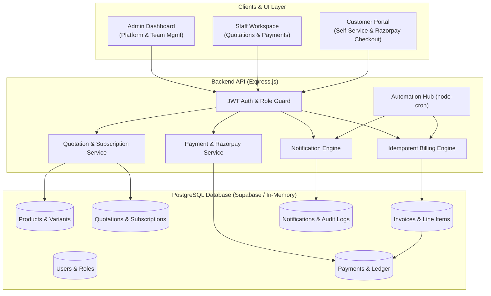
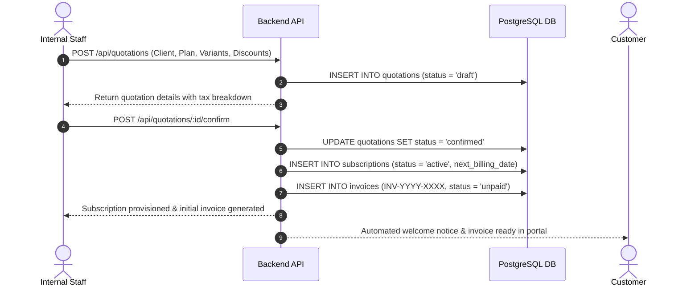
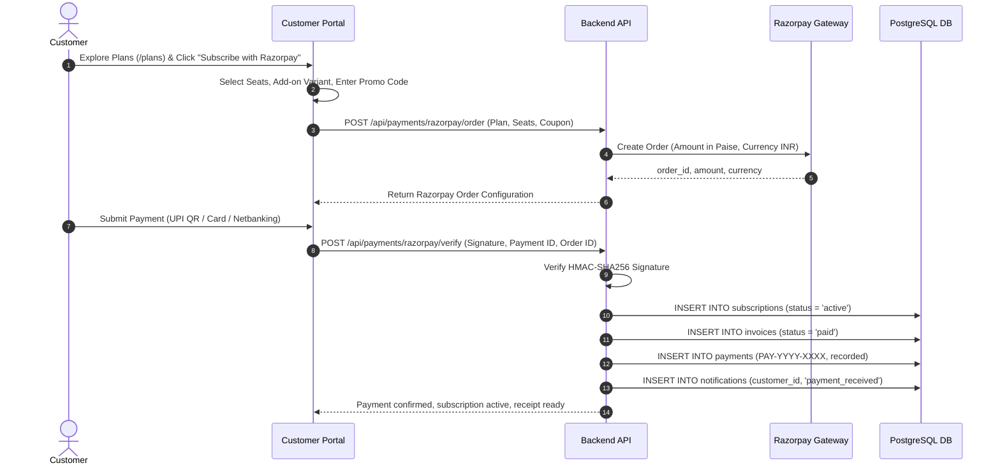
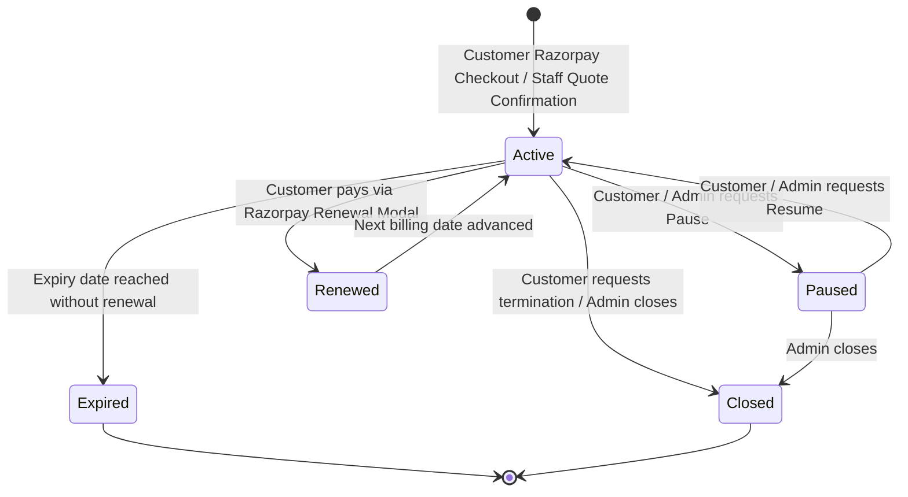
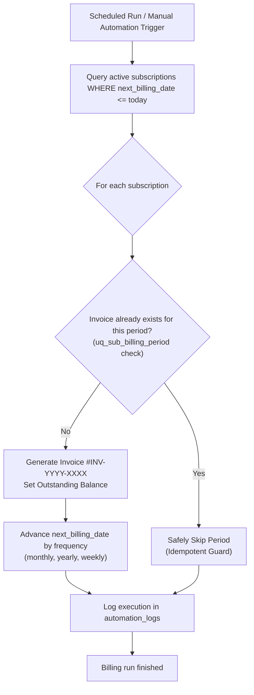
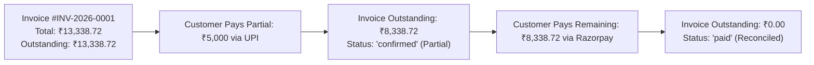
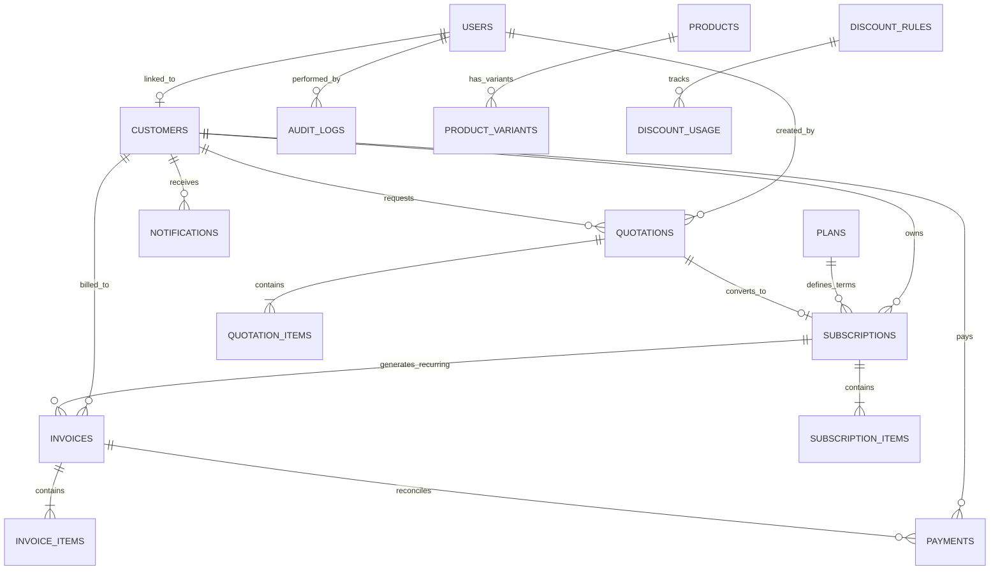

# Brightloop Subscription Management System
https://odoo-beryl.vercel.app/login
> Odoo Hackathon Solution — Subscription Management, Recurring Billing Engine, Quotations, and Customer Self-Service Portal.


---

## Table of Contents
- [Overview](#overview)
- [Quick Start](#quick-start)
- [Demo Credentials](#demo-credentials)
- [User Roles & Responsibilities](#user-roles--responsibilities)
- [Pricing Case Study](#pricing-case-study)
- [Tech Stack](#tech-stack)
- [Architecture & Workflows](#architecture--workflows)
  - [System Architecture](#system-architecture)
  - [Quotation-to-Subscription Workflow](#quotation-to-subscription-workflow)
  - [Customer Self-Service & Razorpay Checkout Workflow](#customer-self-service--razorpay-checkout-workflow)
  - [Subscription Lifecycle](#subscription-lifecycle)
  - [Idempotent Recurring Billing](#idempotent-recurring-billing)
  - [Payment Reconciliation](#payment-reconciliation)
- [Database Schema](#database-schema)
- [Core Features](#core-features)
  - [Razorpay Payment Gateway Integration](#razorpay-payment-gateway-integration)
  - [Customer Self-Service Subscription Catalog](#customer-self-service-subscription-catalog)
  - [Upcoming Expiry Detection & Notification Bell](#upcoming-expiry-detection--notification-bell)
- [Testing](#testing)
- [Security](#security)
- [API Specification](#api-specification)
- [Deployment](#deployment)
- [Project Structure](#project-structure)
- [License](#license)

---

## Overview

Managing recurring billing and subscriptions with spreadsheets creates major operational bottlenecks:
* **Missed Renewals**: Contracts expiring without notice, causing lost recurring revenue.
* **Double-Billing**: Concurrent requests or script restarts charging customers twice in the same billing cycle.
* **Reconciliation Gaps**: Partial payments across UPI, bank transfer, and cash left untracked.
* **Manual Bottlenecks**: Customers unable to explore plans, purchase subscriptions, or renew self-service.
* **Financial Uncertainty**: Inability to report live Monthly Recurring Revenue (MRR) or Annual Recurring Revenue (ARR).

The Brightloop Subscription Management System eliminates these issues:
* Automates recurring invoicing with a scheduled billing engine.
* Integrates Razorpay for seamless self-service checkout and 1-click renewal.
* Delivers automated 7-day upcoming expiry alerts via an interactive Notification Center.
* Prevents double-billing using database-level unique constraints.
* Supports multi-variant pricing, dynamic discounts, and configurable tax rules.
* Provides role-based portals for administrators, sales/operations staff, and customers.
* Built entirely with free and open-source tools with zero paid API dependencies.

---

## Quick Start

The project includes an in-memory PostgreSQL engine (`pg-mem`) with automated disk persistence. You can clone and run it immediately without setting up external database accounts.

### 1. Clone & Install
```bash
git clone https://github.com/tc484472-byte/odoo.git
cd odoo

# Install backend dependencies
cd server
npm install --legacy-peer-deps

# Install frontend dependencies
cd ../client
npm install
```

### 2. Start Application
Run both services in separate terminals:

**Terminal 1 (Backend API):**
```bash
cd server
npm start
# Server running at http://localhost:5000
```

**Terminal 2 (Frontend Client):**
```bash
cd client
npm run dev
# Application running at http://localhost:5173
```

Open `http://localhost:5173` in your browser.

---

## Demo Credentials

The top navigation bar contains a One-Click Persona Switcher for testing:

| Role | Email | Password | Primary Focus |
| :--- | :--- | :--- | :--- |
| **Administrator** | `admin@brightloop.io` | `Password@123` | System control, team management, billing rules, automation |
| **Internal Staff** | `staff@brightloop.io` | `Password@123` | Daily operations, quotations, subscriptions, payment recording |
| **Customer** | `customer@brightloop.io` | `Password@123` | Self-service portal, explore plans, Razorpay checkout, renewal |

---

## User Roles & Responsibilities

The system enforces clear boundaries between three distinct user personas:

### 1. Admin — Controls the entire system
The admin is the owner or system manager who has the highest level of access.

**Responsibilities:**
* Create, edit, and delete products, variants, and subscription plans.
* Configure prices, taxes, and promotional discounts.
* Create staff accounts and secondary administrator accounts, and manage user roles.
* Manage all customers, quotations, and active subscriptions across the company.
* View and manage invoices, payments, and financial reports (MRR, ARR, Cashflow).
* Configure automated billing rules, scheduler settings, and audit logs.

*Example:* The admin launches a new software plan costing ₹2,000 per month and offers a 10% discount to eligible customers.

---

### 2. Internal Staff — Handles daily operations
Staff members help manage customers and billing activities but have limited permissions.

**Responsibilities:**
* View and manage customer profiles and contact details.
* Prepare quotations using templates with dynamic pricing calculations.
* Create and manage subscriptions on behalf of clients.
* Generate, confirm, send, and print invoices according to their permissions.
* Record customer payments (Cash, UPI, Card, Bank Transfer) and reconcile balances.
* Follow up on overdue invoices and payment reminders.
* Monitor subscription and payment statuses.

*Example:* A sales representative prepares a quotation for a customer, converts it into a subscription upon agreement, and records the payment received.

*Note:* Staff cannot create new staff accounts, manage administrator settings, or alter core pricing configs unless explicitly authorized.

---

### 3. Customer — Manages their own subscriptions
Customers access a dedicated, tenant-isolated portal to manage their account and billing information.

**Responsibilities:**
* Register and log in via the customer portal.
* Explore company subscription plans and take/purchase subscriptions self-service using Razorpay.
* View own subscriptions, subscription details, and real-time status.
* View and download professional PDF tax invoices.
* Check payment history, outstanding balances, and transaction receipts.
* Manage permitted subscription lifecycle actions (such as pausing or requesting cancellation).
* Receive 7-day upcoming expiration notifications and renew subscriptions via Razorpay.
* Update account information, company GSTIN, and reset password.

---

## Pricing Case Study

The application contains demonstration data modeling the hackathon case study (Brightloop ERP Core + Odoo Brand Variant):

| Component | Calculation | Amount |
| :--- | :--- | :--- |
| Base Subscription | Brightloop ERP Core Suite | ₹12,000.00 / month |
| Product Variant | Odoo Integration Brand Variant | +₹560.00 |
| **Subtotal** | Base + Variant | **₹12,560.00** |
| Promotional Discount | 10% First-Time Rule | -₹1,256.00 |
| **Taxable Amount** | Subtotal - Discount | **₹11,304.00** |
| Applicable Tax | 18% GST | +₹2,034.72 |
| **Total Payable** | Final Reconciled Amount | **₹13,338.72** |

All automated unit and integration tests verify this exact calculation.

---

## Tech Stack

### Frontend
* **React 19 & Vite**: Fast development tooling and modern component rendering.
* **React Router DOM v7**: Client-side routing, protected routes, and role-based guards.
* **Tailwind CSS v3**: Responsive styling for mobile, tablet, and desktop viewports.
* **Recharts**: Data visualizations for revenue trends, payment distributions, and plan metrics.
* **Lucide React**: Clean vector icon suite.
* **jsPDF & html2canvas**: Client-side downloadable tax invoice generation.
* **Axios**: HTTP client with request interceptors for JWT injection.

### Backend
* **Node.js & Express.js**: REST API with controller-service architecture.
* **Razorpay SDK**: Official integration with signature verification (`crypto` HMAC-SHA256) and zero-config fallback sandbox.
* **JWT & bcryptjs**: Stateless authentication and salted password hashing (10 rounds).
* **express-rate-limit**: Rate limiting on authentication and billing endpoints.
* **dotenv**: Environment variable configuration.

### Database
* **Production**: PostgreSQL on Supabase Free Tier.
* **Local Evaluation**: In-memory PostgreSQL engine (`pg-mem`) with local disk snapshot persistence (`server/data/db_snapshot.json`).
* **Sequence Synchronization**: Automatic primary key sequence tracking across restarts.

### Automation
* **node-cron**: Scheduled background execution for recurring billing, reminders, and expiry checks.
* **GitHub Actions**: Daily external scheduler trigger via `.github/workflows/billing-cron.yml`.

---

## Architecture & Workflows

### System Architecture



---

### Quotation-to-Subscription Workflow



---

### Customer Self-Service & Razorpay Checkout Workflow



---

### Subscription Lifecycle



---

### Idempotent Recurring Billing



---

### Payment Reconciliation



---

## Database Schema



The database schema is defined in [`server/migrations/schema.sql`](server/migrations/schema.sql) across 21 normalized tables. Key database-level guarantees include:
* **Idempotency**: `CONSTRAINT uq_sub_billing_period UNIQUE(subscription_id, billing_period_start)`.
* **Precision**: Monetary columns use `NUMERIC(12, 2)` with `CHECK (col >= 0)`.
* **Integrity**: Cascading deletes on line items and restricted deletes on referenced products.

---

## Core Features

### Razorpay Payment Gateway Integration
* **Dynamic Server-Side Order Creation**: Evaluates plan base price, optional variant add-ons, quantity/seat scaling, promotional coupons, and 18% GST on the server before generating Razorpay orders in paise ($1 \text{ INR} = 100 \text{ paise}$).
* **Signature Verification**: Verifies incoming webhooks and client signatures using cryptographic HMAC-SHA256 with the secret key.
* **Dual Operation Mode**:
  1. **Live / Test Keys**: Plug in your official `RAZORPAY_KEY_ID` and `RAZORPAY_KEY_SECRET` in `server/.env`.
  2. **Sandbox Simulator**: Zero-configuration mode allows hackathon evaluators to test checkout flows without creating a Razorpay account.

### Customer Self-Service Subscription Catalog
* **Explore Plans Page (`/plans`)**: Customers can browse all active plans, view pricing, billing intervals, features, and click "Subscribe with Razorpay".
* **Checkout Modal**: Allows choosing seat counts, selecting optional add-ons (such as Odoo Brand +₹560), applying promo codes (e.g. `WELCOME10`), and viewing live breakdown before confirming payment.
* **Self-Service Lifecycle**: Customers can pause and resume permitted subscriptions directly from their dashboard.

### Upcoming Expiry Detection & Notification Bell
* **7-Day Expiry Engine**: Background scanner detects subscriptions expiring within 7 days.
* **Interactive Notification Center**: Navbar notification bell displays an animated unread badge, category tags, and popover list.
* **1-Click Renewal**: Customers can click "Renew via Razorpay" from the notification popover, dashboard banner, or subscription table to extend their term instantly.

---

## Testing

The project includes an extensive automated test suite covering security, validation, financial calculation, idempotency, Razorpay payment flows, and state machine transitions.

### 1. Run Core Test Suite:
```bash
npm test
```
*Executes all 35 test suites in `server/tests/run-tests.js`.*

### 2. Run Razorpay & Customer Self-Service Flow Test:
```bash
node server/tests/test_razorpay_flow.js
```
*Verifies customer login, plan selection, Razorpay order creation, payment verification, instant subscription provisioning, in-app notifications, pause/resume transitions, and Razorpay renewal.*

### 3. Run Issues & Persistence Verification:
```bash
node server/tests/verify_issues.js
```
*Verifies customer persistence across queries, secondary admin creation, and automation expiry checks.*

---

## Security

* **Customer Isolation**: Customer tokens restrict database queries to records matching `user.customerId`. Unauthorized cross-customer requests return `403 Forbidden`.
* **Password Policy**: Minimum 8 characters with at least one uppercase letter, one lowercase letter, and one special character.
* **Audit Trail**: State changes (user creation, quotation confirmation, payment recording) are logged in `audit_logs` with actor ID, timestamp, and IP address.
* **Rate Limiting**: Endpoint-specific rate limiters mitigate brute-force and credential-stuffing attacks.

---

## API Specification

### Authentication & Team Management
| Method | Endpoint | Role | Description |
| :--- | :--- | :--- | :--- |
| `POST` | `/api/auth/register` | Public | Register customer account |
| `POST` | `/api/auth/login` | Public | Authenticate user & receive JWT token |
| `GET` | `/api/auth/me` | Authenticated | Fetch current profile & role |
| `POST` | `/api/auth/forgot-password` | Public | Request password reset token |
| `POST` | `/api/auth/reset-password` | Public | Reset password with token |
| `GET` | `/api/users` | Admin | List team members (Admins & Staff) |
| `POST` | `/api/users` | Admin | Create Administrator or Staff account |
| `PATCH` | `/api/users/:id/status` | Admin | Toggle account active status |

### Razorpay & Payments
| Method | Endpoint | Role | Description |
| :--- | :--- | :--- | :--- |
| `POST` | `/api/payments/razorpay/order` | All Roles | Create Razorpay order with breakdown |
| `POST` | `/api/payments/razorpay/verify` | All Roles | Verify Razorpay payment, activate/renew sub |
| `GET` | `/api/payments` | Staff, Admin, Customer | List payment records (scoped to customer) |
| `POST` | `/api/payments` | Staff, Admin | Record manual payment (Cash, UPI, Card, Bank) |

### Notifications
| Method | Endpoint | Role | Description |
| :--- | :--- | :--- | :--- |
| `GET` | `/api/notifications` | All Roles | List user notifications & unread count |
| `PATCH` | `/api/notifications/:id/read` | All Roles | Mark specific notification as read |
| `PATCH` | `/api/notifications/read-all` | All Roles | Mark all notifications as read |

### Customers
| Method | Endpoint | Role | Description |
| :--- | :--- | :--- | :--- |
| `GET` | `/api/customers` | Staff, Admin, Customer | List customers (filtered for customer role) |
| `GET` | `/api/customers/:id` | Staff, Admin, Customer | Retrieve customer record, invoices, and subscriptions |
| `POST` | `/api/customers` | Staff, Admin | Create customer and linked user account |
| `PUT` | `/api/customers/:id` | Staff, Admin | Update customer details & GSTIN |

### Products & Plans
| Method | Endpoint | Role | Description |
| :--- | :--- | :--- | :--- |
| `GET` | `/api/products` | All Roles | List products and variant pricing |
| `POST` | `/api/products` | Admin | Create product with base price |
| `POST` | `/api/products/:id/variants`| Admin | Add variant with additional price (+₹560) |
| `GET` | `/api/plans` | All Roles | List active subscription plans |
| `POST` | `/api/plans` | Admin | Create subscription plan |

### Quotations & Subscriptions
| Method | Endpoint | Role | Description |
| :--- | :--- | :--- | :--- |
| `GET` | `/api/quotations` | All Roles | List quotations |
| `POST` | `/api/quotations` | Staff, Admin | Create quotation with items, taxes, discounts |
| `POST` | `/api/quotations/:id/confirm` | Staff, Admin | Confirm quotation and provision subscription |
| `GET` | `/api/subscriptions` | All Roles | List subscriptions |
| `PATCH` | `/api/subscriptions/:id/status`| All Roles | Change state (pause, resume, close) |
| `POST` | `/api/subscriptions/:id/renew` | Staff, Admin | Trigger manual renewal cycle |

### Invoices & Billing Automation
| Method | Endpoint | Role | Description |
| :--- | :--- | :--- | :--- |
| `GET` | `/api/invoices` | All Roles | List invoices (customer scoped) |
| `GET` | `/api/invoices/:id` | All Roles | Invoice details and line items |
| `GET` | `/api/dashboard` | All Roles | Retrieve live MRR, ARR, KPIs, charts |
| `POST` | `/api/automation/billing-run` | Admin | Trigger recurring billing engine |
| `POST` | `/api/automation/overdue-check` | Admin | Trigger overdue invoice detection |
| `POST` | `/api/automation/renewal-reminders` | Admin | Send 7-day renewal reminder notifications |
| `POST` | `/api/automation/expiry-check` | Admin | Scan and update expired subscriptions |
| `GET` | `/api/automation/logs` | Admin | Retrieve background scheduler logs |

---

## Deployment

The system is configured to run at zero cost on free cloud tiers:

### 1. Database: Supabase (PostgreSQL)
1. Create a project at [supabase.com](https://supabase.com).
2. Copy the Connection URI from **Project Settings $\rightarrow$ Database**.
3. Execute [`server/migrations/schema.sql`](server/migrations/schema.sql) in the Supabase SQL Editor.

### 2. Backend: Render (Web Service)
1. Create a Web Service at [render.com](https://render.com) pointing to this repository.
2. Configuration:
   * **Root Directory**: `server`
   * **Build Command**: `npm install --legacy-peer-deps`
   * **Start Command**: `npm start`
3. Environment Variables:
   * `DATABASE_URL`: Your Supabase connection string.
   * `JWT_SECRET`: A secure random secret string.
   * `RAZORPAY_KEY_ID`: Your Razorpay Test Key ID (optional, sandbox active by default).
   * `RAZORPAY_KEY_SECRET`: Your Razorpay Test Secret Key (optional).
   * `NODE_ENV`: `production`
   * `CLIENT_URL`: Your Vercel frontend URL.

### 3. Frontend: Vercel
1. Import repository at [vercel.com](https://vercel.com).
2. Configuration:
   * **Root Directory**: `client`
   * **Environment Variable**: `VITE_API_URL` set to your Render backend URL.
3. Deploy.

---

## Project Structure

```
odoo/
├── client/                     # Frontend React application
│   ├── src/
│   │   ├── components/         # Navbar with Notification Bell, Sidebar, Modals
│   │   ├── context/            # AuthContext & Session management
│   │   ├── pages/              # Dashboard, Plans, Subscriptions, Quotes, Invoices
│   │   └── services/           # Axios API client
│   ├── package.json
│   └── vite.config.js
│
├── server/                     # Backend Express API
│   ├── controllers/            # Payment, Notification, Subscription, User controllers
│   ├── middleware/             # Auth, validation, rate limiting, audit logging
│   ├── migrations/             # schema.sql and seed.js
│   ├── routes/                 # REST endpoint definitions
│   ├── services/               # Razorpay service, billing engine, email simulation
│   ├── tests/                  # run-tests.js, test_razorpay_flow.js, verify_issues.js
│   ├── db.js                   # PostgreSQL & pg-mem connection manager
│   ├── index.js                # Express app entrypoint & cron setup
│   └── package.json
│
├── .github/workflows/          # GitHub Actions billing cron trigger
└── README.md
```

---

## License

This project is licensed under the [MIT License](LICENSE).
